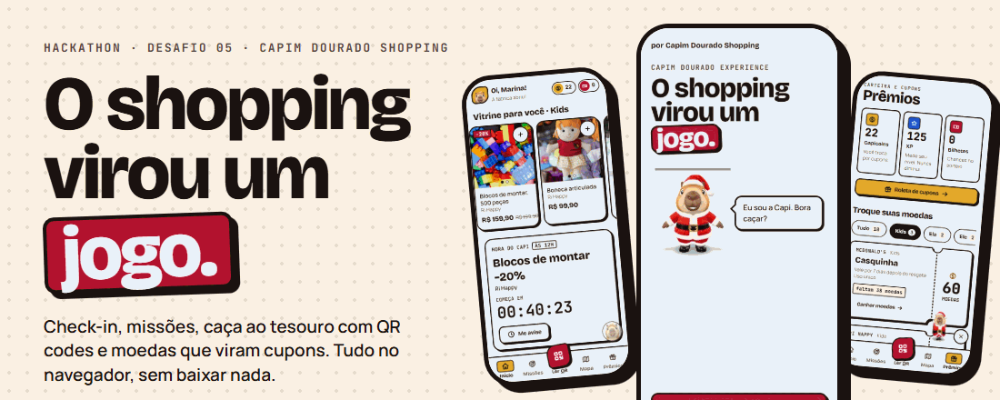
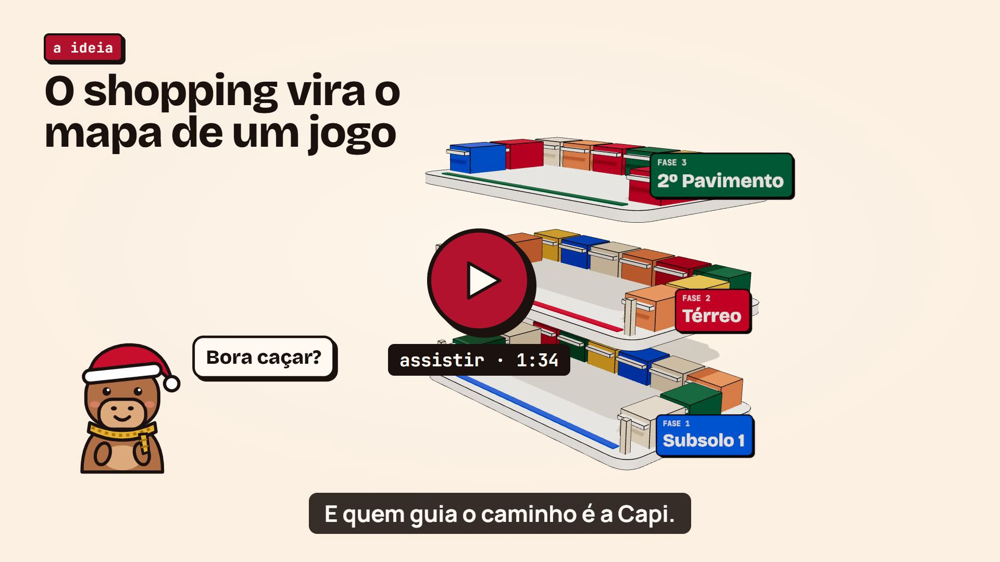
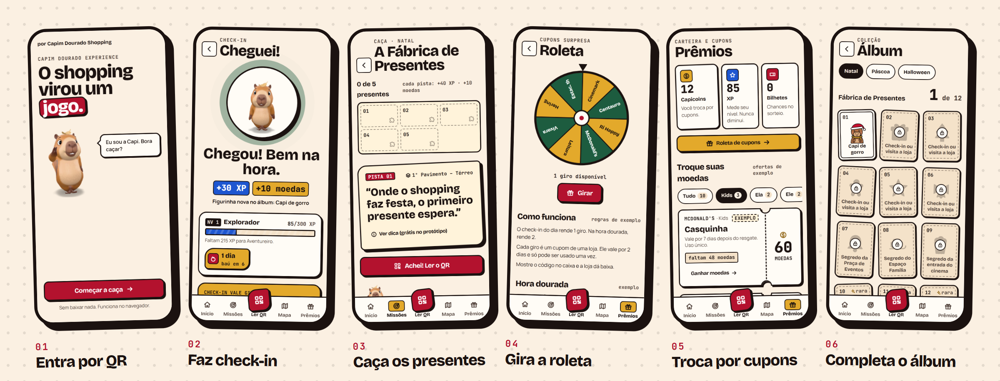
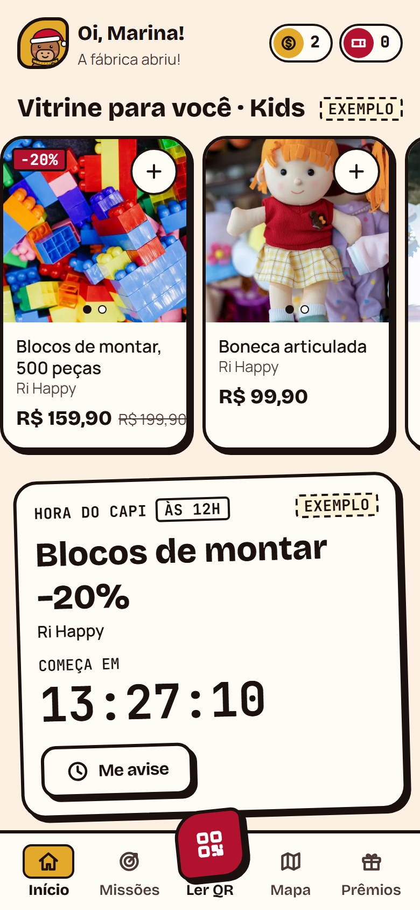
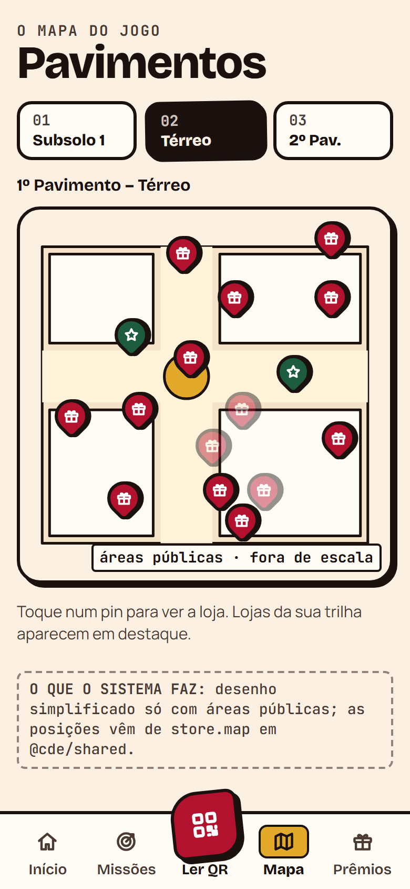
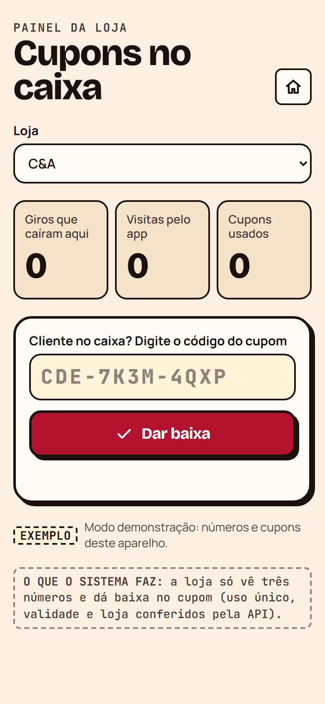
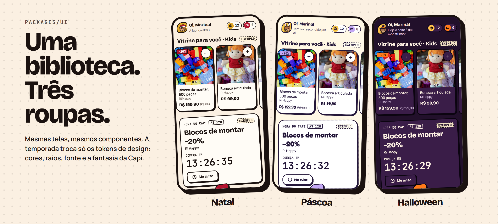
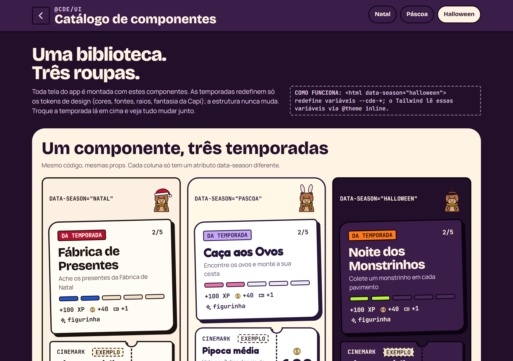
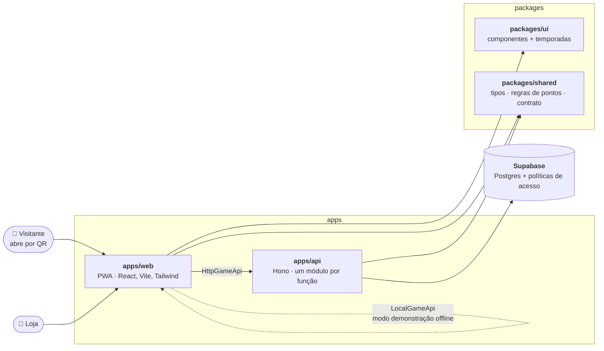

<div align="center">



<br />

**Um jogo dentro do shopping. Chegou, fez check-in, caçou presentes escondidos, trocou moedas por cupons e deu um motivo para voltar.**

<br />


[**Vídeo**](#-vídeo-de-apresentação) ·
[**O problema**](#-o-desafio) ·
[**Como funciona**](#-como-funciona) ·
[**Componentização**](#-componentização-a-tecnologia-do-desafio) ·
[**Testar em 1 minuto**](#-testar-em-1-minuto) ·
[**Arquitetura**](#-arquitetura) ·
[**Documentos**](#-documentos)

</div>

> [!NOTE]
> Projeto de hackathon do **Capim Dourado Shopping** (Palmas, TO). **Desafio 05: engajamento e fidelização dos visitantes.** Tecnologia sorteada: **componentização**.
> Nomes de lojas e pavimentos são reais. **Descontos, prêmios, parcerias e números que aparecem no app são exemplos do protótipo** e vêm marcados como tal na tela.

---

## 🎬 Vídeo de apresentação

<a href="docs/assets/video-apresentacao.mp4">
  
</a>

<br />

Explicador em 3D de **1:34**, com narração e legendas. Ele mostra as dinâmicas na ordem em que o visitante as vive:

| | Cena | O que mostra |
|---|---|---|
| 1 | **Veio. Gostou. Não voltou.** | O problema do desafio 05 em uma frase. |
| 2 | **O mapa** | O shopping se abre em três andares, e cada andar é uma fase. A Capi guia o caminho. |
| 3 | **Cheguei!** | Check-in por localização, uma vez por dia, que rende XP e capicoins. |
| 4 | **Caça ao tesouro** | Cinco QRs da *Fábrica de Presentes*, peças do mapa e o baú com a figurinha rara. |
| 5 | **Hora Dourada** | Giro em dobro na roleta nos horários de baixo movimento, com cupom que vence em 2 dias. |
| 6 | **Prêmios** | Cupons em formato de ingresso, álbum de figurinhas e sequência de 7 dias. |
| 7 | **O mecanismo** | Visita → missão → moedas → cupom → volta, e os três indicadores que o shopping passa a medir. |
| 8 | **Temporadas** | Natal, Halloween e Páscoa com a mesma biblioteca de componentes. |

As telas que aparecem no celular são do próprio app, em modo demonstração. Preços, cupons e horários são **exemplos** e aparecem com o selo "exemplo".

> [!TIP]
> Clique na capa para abrir o vídeo ([`docs/assets/video-apresentacao.mp4`](docs/assets/video-apresentacao.mp4)).

## 🎯 O desafio

O shopping já é o lugar do passeio: segundo a pesquisa Abrasce/Talk, lazer é o papel do shopping para **92% dos frequentadores** ([Mercado&Consumo, 26/06/2026](https://mercadoeconsumo.com.br/26/06/2026/shopping-centers/brasileiro-passa-mais-de-3-horas-no-shopping-que-se-consolida-como-espaco-de-experiencia/amp/)). O que falta é **um motivo para voltar na semana seguinte**. A relação fica na visita pontual, sem vínculo contínuo.

O app oficial do shopping resolve conveniência (lojas, estacionamento, cinema). O **Capim Dourado Experience** completa o app com o que falta: **um jogo**.

| Os grandes (Multiplan, Iguatemi, Allos) premiam o **gasto** | Nós premiamos a **presença e a exploração** |
|---|---|
| Pontos por nota fiscal | Check-in, missões e QR codes escondidos pelo shopping |

E o visitante entra **lendo um QR, sem baixar nada**.

## 🎮 Como funciona



<br />

| | Etapa | O que acontece |
|---|---|---|
| 📍 | **Check-in** | O visitante toca em "Cheguei!". O app confere uma única vez se ele está na área do shopping. Ganha XP, moedas e a sequência de dias começa. |
| 🎯 | **Missões da temporada** | Ex.: a *Fábrica de Presentes* (Natal). Cada pista é uma charada que leva a um ponto do shopping. |
| 🔎 | **Caça ao tesouro com QR** | O QR escondido confirma que a pessoa está *naquele* lugar. O presente abre, entrega peça do mapa, figurinha e moedas. |
| 🎰 | **Roleta de cupons** | Um giro por check-in, em dobro na **hora dourada** (horários de baixo movimento). Cada giro vira um cupom de loja. |
| 🎟️ | **Prêmios** | Moedas viram cupons em formato de ingresso, com código e validade, de uso único. |
| 🗺️ | **Mapa e álbum** | Mapa dos pavimentos com os pontos da caça e álbum de figurinhas por temporada. |
| 🛍️ | **Vitrine e Hora do Capi** | Vitrine por trilha (Kids, Ela, Ele, Para todos) e ofertas relâmpago com contagem regressiva. |
| 🏪 | **Painel da loja** | A loja confere o código do cupom, dá baixa e vê seus números. |

### Três moedas, três papéis

| Moeda | Serve para |
|---|---|
| **XP** | Subir de nível: Explorador → Aventureiro → Caçador → Mestre do Shopping |
| **Capicoins** | Trocar por cupons nas lojas |
| **Bilhetes** | Participar de sorteio (simulado no MVP) |

Quem guia tudo é a **Capi**, uma capivara em 3D, e a turma: Jalapa, Buriti e Sussa.

<table>
  <tr>
    <td width="33%"></td>
    <td width="33%"></td>
    <td width="33%"></td>
  </tr>
  <tr align="center">
    <td><sub><b>Início</b> · vitrine e Hora do Capi</sub></td>
    <td><sub><b>Mapa</b> · pavimentos e pontos da caça</sub></td>
    <td><sub><b>Painel da loja</b> · baixa de cupons</sub></td>
  </tr>
</table>

## 🧩 Componentização: a tecnologia do desafio



<br />

Um shopping vive de calendário: Natal, Páscoa, Dia das Crianças, Halloween. Em vez de reescrever telas a cada data, **todas as telas são montadas com uma única biblioteca de componentes** ([`packages/ui`](packages/ui)), e **cada temporada troca só os tokens de design**: cores, raios, fonte e a fantasia da Capi.

```html
<html data-season="halloween">   <!-- redefine as variáveis --cde-*; o Tailwind lê via @theme inline -->
```

- **Nenhuma tela é reescrita** para mudar de temporada. A estrutura nunca muda.
- **A mesma biblioteca serve o app do visitante e o painel da loja.**
- **O catálogo é uma tela do próprio app**: abra [`/catalogo`](#-testar-em-1-minuto), veja todos os componentes e troque a temporada ao vivo.
- **A API segue a mesma ideia**: um módulo independente por funcionalidade, cada um com `controller`, `service` e `repository`.

<details>
<summary><b>Os componentes de <code>@cde/ui</code></b></summary>

<br />

`Button` · `Card` · `Chip` · `Tag` · `Sheet` · `Spinner` · `Icon` · `CountUp` · `BottomNav` · `FloorTabs` · `MissionCard` · `XpBar` · `StatusRing` · `StreakChip` · `WalletBadge` · `CouponTicket` · `StickerCard` · `StickerArt` · `MapPin` · `PuzzleMap` · `RouletteWheel` · `ScannerFrame` · `TreasureReveal` · `AchievementToast` · `SeasonBanner` · `Capi` · `SpeechBubble` · `SystemNote` · `PhoneFrame`

</details>



## 🚀 Testar em 1 minuto

Requisitos: **Node 24** (veja [`.nvmrc`](.nvmrc)) e npm.

```bash
npm install
npm run dev:web
```

O app abre em **modo demonstração**, com dados locais: **sem API, sem banco, sem GPS e sem câmera**. Dá para jogar o fluxo inteiro offline.

| Rota | O que mostra |
|---|---|
| `/` | O jogo, começando pelo onboarding |
| `/catalogo` | Catálogo de componentes com troca de temporada ao vivo |
| `/loja` | Painel da loja (dar baixa em cupom) |
| `/?demo=1` | Força o modo demonstração e abre o painel de extras (reiniciar, adiantar dias, hora dourada) |

```bash
npm run dev:api      # API em memória, sem configuração
npm run check        # lint, tipos, testes e build (o mesmo do CI)
```

## 🧱 Arquitetura



```text
apps/
  web/        PWA do visitante e painel da loja (React, Vite, Tailwind)
  api/        API Node (Hono) em camadas: album, checkin, hunts, missions, panel, points,
              qr, raffles, rewards, roulette, stores e users
packages/
  ui/         biblioteca de componentes e temas por temporada
  shared/     tipos, regras de pontos, dados iniciais e contrato da API (GameApi)
supabase/     migrações SQL, políticas de acesso e seed
docs/         entrega, guias, pesquisa e material da apresentação
.github/      pipelines, modelos de issue e de pull request
```

**Decisões que importam:**

- **O contrato manda.** App e API se entendem só por `GameApi`, `ROUTES` e os tipos de `@cde/shared`. É isso que deixa o app rodar contra a API real **ou** contra o `LocalGameApi` do navegador, sem mudar uma tela.
- **Pontos calculados só no servidor.** Com a API, o app nunca decide quanto vale uma ação. As regras ficam em `packages/shared`, com limites diários.
- **QR assinado.** O token é um HMAC-SHA256 com expiração opcional, para reduzir foto compartilhada.

### Pensado para dar certo no mundo real

| Risco | Como tratamos |
|---|---|
| GPS erra dentro do prédio | O **QR físico** confirma o local; o GPS só confirma a área do shopping |
| Localização é dado pessoal (LGPD) | Consentimento explícito antes do aviso do navegador. Guardamos **só o resultado** ("estava ou não"), nunca o trajeto |
| Crianças (ECA Digital) | Trilha Kids **sem ranking**, moedas nunca à venda, baú com conteúdo anunciado |
| Sorteio exige autorização federal | No MVP o sorteio é **simulado**; o piloto prevê a autorização |
| Fraude de pontos | Cálculo no servidor, limite diário, cupom de uso único conferido pela loja |
| Acessibilidade | Contraste AA, alvos de toque de 44 px, foco visível e respeito a `prefers-reduced-motion` |

## 📈 O que o shopping passa a medir

Hoje o shopping não tem estes três números. O jogo os produz. Ainda **não há resultado medido** e nenhum valor é inventado; as metas se combinam no piloto.

1. **Retorno em 7 dias**: quem volta na semana seguinte
2. **Cupons usados nas lojas**: quantos viram visita e venda
3. **Lojas visitadas por visita**: quantas lojas cada visitante percorre

## 🧭 Próximos passos

- [ ] **Piloto no Natal**, combinando metas e operação com o shopping
- [ ] Conferir em campo o **polígono do check-in** (a proposta vem do OpenStreetMap)
- [ ] Alinhar com o jurídico a autorização do **sorteio real** e de brindes por missão
- [ ] Avaliar a **integração com o app oficial** do shopping (um botão "Jogar")

## 📚 Documentos

| Documento | Para quê |
|---|---|
| [Roteiro da apresentação](docs/pesquisa/apresentacao.md) | Abertura, roteiro de 5 minutos, demonstração com plano B e perguntas dos jurados |
| [Pesquisa](docs/pesquisa/README.md) | Casos de gamificação, dados de mercado com fonte, fatos do shopping e regras legais |
| [Planejamento técnico inicial](docs/planejamento-tecnico-inicial.md) | Primeira entrega: telas, requisitos, arquitetura e tecnologias |
| [Guia da Caça no Shopping](docs/guia/guia-gamificacao-shopping.html) | Mecânica explicada do zero e prompts de cada tela |
| [Guia de Vercel e Supabase](docs/guia-vercel-supabase.md) | Passo a passo de publicação e configuração |
| [Orquestração de agentes](docs/agentes.md) | Como o trabalho é dividido entre agentes e pessoas |
| [AGENTS.md](AGENTS.md) | Regras para quem (ou o que) escreve código aqui |

## 🤝 Contribuindo

<details>
<summary><b>Fluxo de trabalho e pipelines</b></summary>

<br />

1. Cada tarefa vira uma issue.
2. Crie uma branch a partir da `main` (`feat/checkin`, `fix/cupom-expirado`).
3. Abra um pull request com título no padrão [Conventional Commits](https://www.conventionalcommits.org/pt-br) (`feat(web): adiciona a tela de check-in`).
4. O CI roda lint, tipos, testes e build. A Vercel publica uma prévia do pull request.
5. Merge por squash na `main`. A Vercel publica em produção.

| Workflow | Quando roda | O que faz |
|---|---|---|
| `ci` | Pull request e push na `main` | Biome, `typecheck`, testes e build de todos os pacotes. O check obrigatório é o `ci-gate`. |
| `pr-title` | Pull request | Valida o título no padrão Conventional Commits. |
| `security` | Pull request, push na `main` e toda segunda | Gitleaks (segredos). CodeQL e revisão de dependências rodam só em repositório público. |

O deploy não passa pelo GitHub Actions: é feito pela integração da Vercel com o GitHub.

</details>

<div align="center">

<br />

**O Capim Dourado virou um mapa.** 🐹

<sub>Feito em um hackathon financiado pelo Capim Dourado Shopping · Palmas, Tocantins</sub>

</div>
