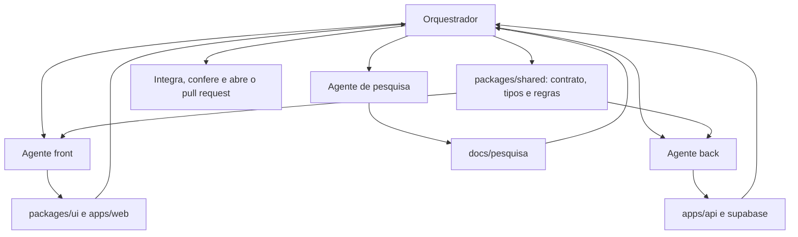

# Orquestração de agentes

O projeto é construído por um **orquestrador** e três **agentes especializados** que trabalham em paralelo. As regras que todos seguem estão no [AGENTS.md](../AGENTS.md).

## Papéis

| Papel | Pasta | Responsabilidade |
|---|---|---|
| **Orquestrador** | raiz, `.github/`, `packages/shared`, `docs/` | Define o contrato antes de todos, distribui o trabalho, confere os resultados, integra e versiona. |
| **Pesquisa** | `docs/pesquisa` | Casos reais, dados de mercado com fonte, regras legais e roteiro da apresentação. |
| **Front** | `packages/ui`, `apps/web` | Biblioteca de componentes, temas por temporada e as telas do app. |
| **Back** | `apps/api`, `supabase/` | API em camadas por módulo, regras no servidor, banco e políticas de acesso. |

## Por que funciona em paralelo

1. **O contrato vem primeiro.** O orquestrador escreve `packages/shared` (tipos, regras de pontos, dados iniciais, `GameApi` e `ROUTES`) antes de lançar os agentes. Front e back programam contra o mesmo contrato, sem depender um do outro.
2. **Pastas sem sobreposição.** Cada agente só escreve na própria pasta. Dois agentes nunca editam o mesmo arquivo.
3. **Dependências congeladas.** O orquestrador instala tudo antes. Agentes não rodam `npm install`, o que evita corromper o `node_modules` compartilhado.
4. **O app não espera a API.** O app tem uma implementação local do contrato (modo demonstração) e outra por HTTP. A demonstração funciona mesmo sem API publicada.
5. **Relatório não é prova.** Cada agente entrega um relatório com o que verificou. O orquestrador roda `npm run check` e confere antes de integrar.

## Ciclo de uma rodada

1. O orquestrador atualiza o contrato e as tarefas.
2. Os agentes trabalham em paralelo, cada um na sua pasta.
3. Cada agente roda as verificações do seu pacote e entrega o relatório.
4. O orquestrador roda a verificação completa, corrige a integração e registra as lacunas de contrato apontadas.
5. O trabalho entra por pull request, com o CI rodando.

## Como repetir com pessoas

A mesma divisão vale para o grupo: uma pessoa por área, o contrato em `packages/shared` combinado antes, e cada mudança de contrato feita em um pull request próprio, revisado por quem cuida do app e da API.
