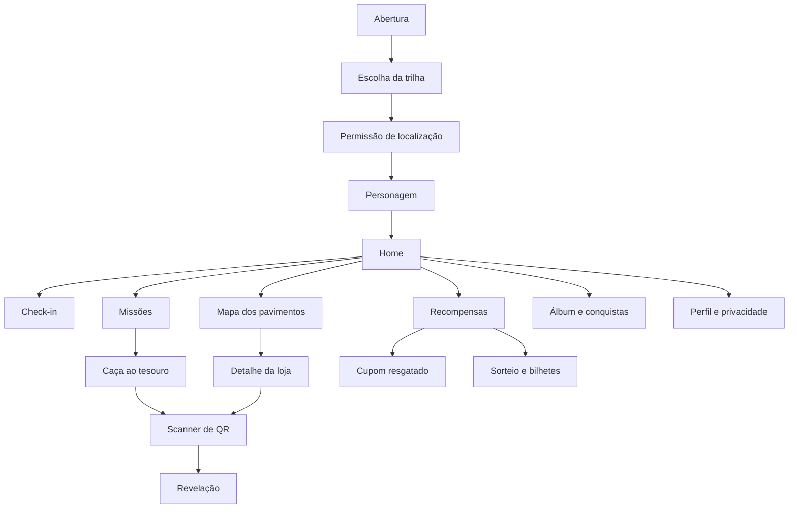
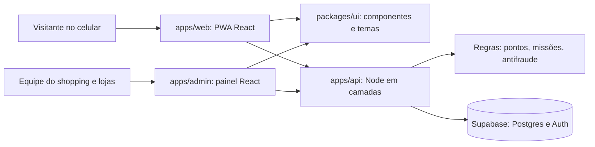
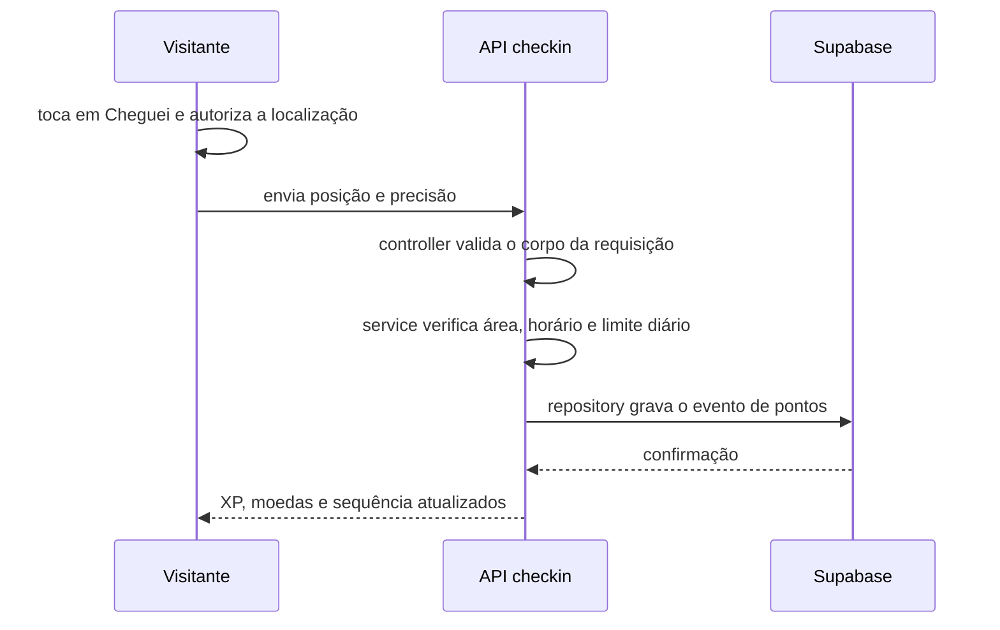

# Capim Dourado Experience

**Planejamento técnico inicial · Primeira entrega**

| | |
|---|---|
| **Desafio** | 05. Engajamento e fidelização dos visitantes |
| **Cliente / caso** | Capim Dourado Shopping, Palmas (TO) |
| **Equipe** | [NOME DA EQUIPE] |
| **Integrantes** | [NOMES] |
| **Data** | 13/11/2026 |
| **Versão** | 1.0 (planejamento e definição técnica; não é a entrega final do MVP) |

> Pontos marcados com **[A CONFIRMAR]** dependem de decisão do grupo ou de confirmação com o shopping. Valores de pontos, descontos e prêmios são exemplos para o protótipo.

---

## 1. Resumo da solução

O **Capim Dourado Experience** é um web app (PWA) que transforma a visita ao shopping em um jogo. O visitante abre o app no celular, faz check-in ao chegar, cumpre missões, procura QR codes escondidos e acumula pontos que viram cupons e chances em sorteios. A turma de capivaras do jogo guia a experiência, e a temporada muda ao longo do ano (Natal, Páscoa e Halloween), sempre ligada às atrações do shopping.

O app é uma **extensão do shopping** e responde diretamente ao problema do desafio: dar ao visitante um motivo para voltar, e não só para comprar uma vez. Pontua-se mais por estar no shopping do que por abrir o app, e o shopping e as lojas recebem um painel para criar missões, cupons e acompanhar indicadores.

A tecnologia sorteada, e obrigatória na apresentação, é a **componentização**: uma biblioteca de componentes reutilizáveis que serve ao app do visitante e ao painel, e que troca de tema por temporada mudando apenas tokens de design.

---

## 2. Proposta e estrutura inicial das telas

### 2.1 Persona

**Marina, 34 anos, mãe de um menino de 8.** Mora em Palmas e vai ao shopping uma ou duas vezes por mês, geralmente para o cinema ou para a praça de alimentação. Usa o celular o dia todo, mas não instala aplicativos novos com facilidade. Quer uma programação que agrade o filho sem gastar muito.

*O que ela precisa:* um motivo concreto para voltar, algo que o filho goste de fazer e uma recompensa que valha o esforço.

### 2.2 Jornada

| # | Momento | O que acontece | Tela |
|---|---|---|---|
| 1 | Chegada | Marina lê o QR da entrada e abre o app no navegador, sem baixar nada. | Abertura |
| 2 | Cadastro | Escolhe a trilha (Kids, Ela, Ele ou Para todos) e o personagem. | Trilha e personagem |
| 3 | Localização | Uma tela explica por que o app pede a localização antes do aviso do celular. | Permissão |
| 4 | Check-in | Toca em "Cheguei!". O app confere se ela está na área do shopping e dá XP e moedas. | Check-in |
| 5 | Missão | Recebe a missão da temporada e procura os QR codes escondidos pelo shopping. | Missões, Caça e Scanner |
| 6 | Loja | Lê o QR de uma loja parceira, soma pontos e libera um cupom. | Mapa e Detalhe da loja |
| 7 | Troca | Na carteira, troca moedas por um cupom (ex.: sorvete para o filho) e guarda bilhetes do sorteio. | Recompensas |
| 8 | Volta | Mantém a sequência de dias, com um baú no sétimo dia. | Home |

### 2.3 Mapa de telas



### 2.4 Telas principais

[INSERIR IMAGENS: uma por tela, geradas a partir dos prompts do grupo]

| Tela | Objetivo | Componentes principais | Estados previstos |
|---|---|---|---|
| **Abertura** | Primeira impressão e entrada na caça. | Mascote, título, botão primário. | Primeiro acesso, retorno. |
| **Trilha e personagem** | Personalizar cupons e visual. | Cartão de escolha, seletor de personagem. | Nenhuma trilha escolhida, trilha escolhida. |
| **Permissão de localização** | Explicar o uso da localização e pedir autorização. | Texto curto, botões "Permitir" e "Agora não". | Permitida, negada, indisponível. |
| **Home** | Mostrar progresso e o próximo passo. | Barra de XP, chip de sequência, cartão de missão do dia, faixa da temporada, navegação inferior. | Sem localização, primeiro acesso, sequência em risco. |
| **Check-in** | Registrar presença no shopping e premiar. | Anel de status, botão "Cheguei!", contador de pontos, plano B por QR. | Antes, verificando, sucesso, fora da área, GPS impreciso, já feito hoje. |
| **Caça ao tesouro e Scanner** | Guiar a procura pelos QR codes e revelar as peças do mapa. | Cartão de pista, barra de progresso, moldura de scanner, peça do mapa. | Pista atual, QR válido, QR inválido ou repetido, baú final. |
| **Mapa dos pavimentos** | Localizar lojas, segredos e eventos. | Abas Térreo, 2º Pavimento e Estacionamento, pin do mapa, cartão da loja. | Pavimento ativo, loja selecionada. |
| **Recompensas** | Trocar moedas por cupons e bilhetes. | Carteira, filtros de trilha, cupom em formato de ingresso, botão de resgate. | Saldo insuficiente, cupom expirado, catálogo vazio, resgatado. |
| **Álbum e conquistas** | Dar motivo para voltar por coleção. | Cartinha de figurinha (comum e rara), aviso de conquista. | Desbloqueada, trancada, temporada passada. |

### 2.5 Painel do shopping e das lojas

Interface para computador, usada pela equipe do shopping e pelos lojistas.

- Visitantes ativos, retorno em 7 dias, check-ins do dia e cupons resgatados.
- Lojas mais visitadas a partir do jogo.
- Criar missão, gerar QR de segredo ou de loja, cadastrar cupom e marcar uso.
- Calendário de temporadas.

### 2.6 Direção visual

- **Personagem:** a turma de capivaras (a Capi), com identidade própria e acessório de capim dourado trançado.
- **Cores:** vermelho, preto e azul do jogo, com o logotipo do Capim Dourado Shopping e um toque de dourado.
- **Mapa:** o shopping como mapa do jogo, usando os nomes oficiais dos pavimentos: *1º Pavimento – Térreo*, *2º Pavimento – Praça de Alimentação* e *Subsolo 1*. Os mapas mostram só áreas públicas.
- **Temporadas:** Natal (Fábrica de Presentes), Páscoa (Caça aos Ovos) e Halloween (Noite dos Monstrinhos).

---

## 3. Documentação inicial do projeto

### 3.1 Contexto, problema e objetivo

- **Contexto:** o shopping busca atrair visitantes, estimular novas visitas e fortalecer o relacionamento com seu público.
- **Problema:** a relação entre o consumidor e o shopping muitas vezes se limita à visita ou ao consumo pontual, sem necessariamente gerar um vínculo contínuo.
- **Objetivo:** ampliar o relacionamento, a participação e o engajamento dos visitantes com o shopping.
- **Hipótese da solução:** um jogo com recompensa por presença, exploração e retorno transforma a visita pontual em hábito.

### 3.2 Público e interessados

| Grupo | Interesse |
|---|---|
| Visitantes adultos | Descontos, cupons, algo para fazer no shopping. |
| Famílias e crianças (via responsável) | Atividade lúdica e prêmios infantis. |
| Shopping (financiador do hackathon) | Mais visitas, retorno e dados de comportamento agregados. |
| Lojistas | Visitantes novos e cupons controlados. |
| Operação do shopping | Aprovar locais de QR e conferir resgates. |

### 3.3 Escopo do MVP

**Entra no MVP**
- Cadastro, trilha e personagem.
- Check-in por localização com plano B por QR.
- Visita a loja por QR.
- Missões, caça ao tesouro e segredos.
- Carteira, loja de recompensas e cupons.
- Sequência de dias e álbum.
- Tema de Natal completo, com troca de tema demonstrável.
- Painel básico do shopping e das lojas.
- Um único shopping: Capim Dourado.

**Fica fora (roadmap)**
- Pontos por compra, com integração a nota fiscal ou caixa.
- Sorteio real (no MVP é simulado).
- Mais de um shopping.
- Notificações push com o app em segundo plano.
- Ranking público.

### 3.4 Requisitos funcionais

| Código | Requisito |
|---|---|
| RF01 | Cadastro e login com consentimento. |
| RF02 | Escolha de trilha (Kids, Ela, Ele, Para todos) e de personagem. |
| RF03 | Pedido de localização com explicação prévia; o app funciona sem ela, com menos pontos. |
| RF04 | Check-in "Cheguei!" validado no servidor (área, horário, uma vez por dia). |
| RF05 | Check-in alternativo por QR na entrada. |
| RF06 | Visita a loja parceira por QR, com limites. |
| RF07 | Missões diárias, semanais e de temporada, com progresso. |
| RF08 | Caça ao tesouro com pistas em ordem, QR e peças de mapa. |
| RF09 | Segredos: QR escondidos avulsos. |
| RF10 | Sequência de dias com dia de folga e baú no sétimo dia. |
| RF11 | Carteira com XP, moedas e bilhetes. |
| RF12 | Loja de recompensas com cupons gerais e por loja, filtro por trilha, resgate com código e validade. |
| RF13 | Sorteio com bilhetes (simulado no MVP). |
| RF14 | Álbum de figurinhas por temporada. |
| RF15 | Temporadas com troca de tema. |
| RF16 | Painel: criar missão, gerar QR, cadastrar cupom, marcar uso e ver indicadores. |
| RF17 | Perfil com histórico e opção de apagar conta e dados. |

### 3.5 Requisitos não funcionais

| Código | Requisito |
|---|---|
| RNF01 | Mobile first, com layout testado entre 360 e 430 px de largura; painel em desktop. |
| RNF02 | Segurança: pontos e validações calculados no servidor; regras de acesso por usuário no banco. |
| RNF03 | Privacidade e LGPD (seção 3.8). |
| RNF04 | Acessibilidade: contraste AA, alvo de toque mínimo de 44 px, respeito a "reduzir movimento". |
| RNF05 | Desempenho: carregamento inicial rápido em rede móvel. Meta numérica [A CONFIRMAR]. |
| RNF06 | Compatibilidade com Chrome (Android) e Safari (iOS). |
| RNF07 | Manutenibilidade: componentização, camadas por módulo e tipos compartilhados. |
| RNF08 | Observabilidade: registro de eventos e erros. |
| RNF09 | Qualidade: verificação automática (lint, tipos e testes) a cada pull request. |

### 3.6 Regras de negócio

| Código | Regra |
|---|---|
| RN01 | Um check-in por dia por usuário. |
| RN02 | Check-in e QR só valem no horário de funcionamento: lojas de segunda a sábado, 10h às 22h, e domingo, 14h às 20h; restaurantes de segunda a sábado, 11h às 22h, e domingo, 11h às 20h. |
| RN03 | Máximo de 5 lojas por dia e uma visita por loja por dia. |
| RN04 | Cada segredo só pontua uma vez por usuário. |
| RN05 | As pistas da caça são cumpridas em ordem. |
| RN06 | XP nunca diminui. Moedas são gastas na loja de recompensas. Bilhetes valem em sorteios. |
| RN07 | Cupom tem uso único e validade. |
| RN08 | A sequência de dias tem um dia de folga por semana. |
| RN09 | Pontos são calculados somente no servidor. |
| RN10 | QR codes têm token que expira ou muda, para reduzir o uso de foto compartilhada. |
| RN11 | Trilha Kids: conta ligada a um responsável, sem ranking e sem localização exata. |
| RN12 | Há um limite diário de pontos por usuário. Valor [A CONFIRMAR]. |

**Tabela de pontos (exemplos para o protótipo)**

| Ação | XP | Moedas | Limite |
|---|---|---|---|
| Abrir o app no dia | +5 | +2 | 1 por dia |
| Check-in no shopping | +30 | +10 | 1 por dia |
| Visita a loja parceira (QR) | +15 | +5 | 5 lojas por dia, 1 vez por loja |
| Segredo encontrado | +50 | +15 | Uma vez por segredo |
| Pista da caça ao tesouro | +40 | +10 | Em ordem |
| Missão da temporada concluída | +100 | +40 | Mais uma figurinha |
| Sequência de 7 dias | +60 | +30 | Baú com bilhete |
| Amigo convidado que entra | +50 | +20 | Até 5 por mês |

**Níveis:** Explorador (0 XP), Aventureiro (300 XP), Caçador (800 XP) e Mestre do Shopping (1.800 XP). Os valores serão ajustados com dados do piloto.

### 3.7 Riscos e mitigações

| Risco | Mitigação |
|---|---|
| O GPS dentro do prédio é impreciso. | O GPS só confirma "estou na área do shopping". O QR confirma "estou nesta loja ou neste ponto". |
| Um web app não lê a localização em segundo plano. | Check-in por botão, com o app aberto. |
| Subsolo sem bom sinal de GPS. | QR na entrada do estacionamento. |
| Fraude: localização falsa, QR compartilhado. | Validação no servidor, QR com token que expira, limites diários e cupom de uso único conferido pela loja. |
| LGPD: localização e dados de crianças. | Consentimento próprio, coleta mínima e conta de menor vinculada ao responsável (seção 3.8). |
| Regras de sorteio promocional no Brasil. | Sorteio simulado no MVP; confirmar exigências com o orientador e o jurídico do shopping. |
| Baixa adesão por falta de motivo para abrir o link. | QR de entrada, comunicação nas atrações e recompensas visíveis desde o primeiro dia. |
| QR em locais sem aval da Operação. | Colocar QR só em áreas públicas e combinar cada local com a Operação. |
| Custo dos prêmios. | Lojas bancam os descontos; o shopping banca os prêmios do sorteio. |
| Escopo grande para o tempo do hackathon. | Priorizar Check-in, Caça ao tesouro e Recompensas; Natal como única temporada completa. |
| Notificações limitadas no iPhone. | Push só com o app instalado na tela inicial; fica como item opcional. |

### 3.8 LGPD e privacidade

- **Consentimento próprio.** O consentimento já existente no site do shopping cobre apenas o envio de newsletter. O jogo coleta localização, perfil e uso de cupons, e por isso pede consentimento específico, em linguagem simples.
- **Minimização.** O sistema guarda apenas o resultado da verificação (dentro ou fora da área, com data e hora). A trilha de movimentos do usuário não é guardada. [A CONFIRMAR com a equipe técnica]
- **Finalidade clara.** A localização só é usada para validar presença no shopping.
- **Direitos do titular.** O perfil permite consultar o histórico e apagar a conta e os dados.
- **Crianças e adolescentes.** O tratamento de dados de crianças exige consentimento de um dos pais ou do responsável (LGPD, art. 14). No MVP, o responsável cria a conta e a criança joga dentro dela, sem ranking e sem localização exata.
- **Encarregado de dados.** [A CONFIRMAR com o shopping]

### 3.9 Indicadores de sucesso

| Indicador | O que mostra |
|---|---|
| Visitas por usuário por mês | Frequência de retorno. |
| Retorno em 7 dias | Formação de hábito. |
| Check-ins por dia | Presença no shopping. |
| Lojas visitadas por visita | Circulação pelo shopping. |
| Missões concluídas | Engajamento com o jogo. |
| Cupons resgatados e usados | Valor entregue às lojas. |
| Uso por trilha | Interesse de cada perfil. |

As metas numéricas serão definidas junto com o shopping no piloto. [A CONFIRMAR]

---

## 4. Linguagem de programação escolhida

**TypeScript**, no front-end e na API.

- Uma linguagem só reduz a troca de contexto e permite compartilhar tipos e regras entre o app, o painel e a API (pacote `packages/shared`).
- A tipagem estática evita erros comuns de integração, importante em um projeto com prazo curto.
- Ecossistema amplo para React, Node e Supabase, e o grupo já domina a linguagem.

---

## 5. Arquitetura proposta

### 5.1 Visão geral



### 5.2 Front-end em monorepo

```text
capim-dourado-experience/
  apps/
    web/      PWA do visitante (React, Vite)
    admin/    painel do shopping e das lojas
    api/      API Node em camadas, por módulo
  packages/
    ui/       componentes e temas (Natal, Páscoa, Halloween)
    shared/   tipos, validações e regras de pontos
    config/   ESLint, TypeScript, Tailwind
  docs/       documentos da entrega e decisões
  .github/    CI, modelos de issue e de pull request
```

O monorepo mantém app, painel, API e componentes no mesmo repositório, com pacotes compartilhados, e um único processo de verificação automática. Gerenciador de pacotes e orquestração de tarefas: pnpm workspaces e Turborepo. [A CONFIRMAR]

### 5.3 API Node em camadas, organizada por módulo

```text
apps/api/src/
  modules/
    auth/
    users/
    checkin/    controller, service, repository, dto
    missions/
    qr/
    rewards/    cupons e loja de recompensas
    raffles/    bilhetes e sorteios
    stores/
  shared/       erros, validação, autenticação, logs
  server.ts
```

| Camada | Responsabilidade |
|---|---|
| **Controller** | Recebe a requisição, valida a entrada e devolve a resposta. Não tem regra de negócio. |
| **Service** | Concentra as regras: limites diários, horário, cálculo de pontos e antifraude. |
| **Repository** | Único ponto de acesso ao Supabase. |
| **DTO** | Formato de entrada e saída de cada operação, validado. |

Cada camada só chama a de baixo, e cada módulo pode evoluir sem alterar os outros.

### 5.4 Fluxo de um check-in



A área do shopping é um polígono desenhado no mapa, que cobre o prédio e o estacionamento externo, e não um simples raio, porque o terreno é grande. No Subsolo 1, onde o GPS é fraco, vale o QR.

### 5.5 Segurança e antifraude

- Pontos e limites são calculados no servidor, nunca no celular.
- Regras de acesso por usuário no banco (Row Level Security do Supabase).
- QR codes com token que expira ou muda.
- Cada pontuação vira um evento imutável em um registro de pontos (ledger), o que permite auditar e corrigir.
- Cupons com código único, validade e uso único, marcados como usados pela loja no painel.

### 5.6 Modelo de dados inicial

| Entidade | Conteúdo |
|---|---|
| `users` e `profiles` | Conta, trilha, personagem e consentimentos. |
| `seasons` | Temporadas e seus temas. |
| `missions` e `mission_progress` | Missões e o progresso de cada usuário. |
| `qr_codes` | Segredos, pistas e QR de lojas, com validade. |
| `point_events` | Registro imutável de XP e moedas. |
| `stores` | Lojas parceiras. |
| `coupons` e `redemptions` | Ofertas e resgates. |
| `raffles` e `tickets` | Sorteios e bilhetes. |
| `checkins` | Resultado do check-in (dentro ou fora, data e hora). |

---

## 6. Plataforma e tecnologias adotadas

| Camada | Escolha | Motivo |
|---|---|---|
| Plataforma | Web app PWA, mobile first | Abre por QR ou link, sem loja de apps, em qualquer celular. |
| Linguagem | TypeScript | Mesma linguagem no front e na API, com tipos compartilhados. |
| Organização do front | Monorepo (pnpm workspaces e Turborepo) | App, painel e componentes compartilhados sem duplicar código. |
| Interface | React, Vite e Tailwind; Framer Motion para animações | Rápido de montar e adequado a telas animadas. |
| Componentização | `packages/ui` com tokens de design e temas por temporada | Tecnologia sorteada; mesmos componentes no app, no painel e nas temporadas. |
| Mapa dos pavimentos | SVG simplificado a partir da planta | O GPS interno é impreciso, e o desenho mostra os pavimentos com clareza. |
| Localização | API de geolocalização do navegador e verificação de área no servidor | Sem custo e sem dependência externa. |
| QR codes | Leitura por câmera (html5-qrcode) e geração (qrcode), com token que expira | Funciona no navegador do celular. |
| API | Node e TypeScript em camadas (controller, service, repository), um módulo por funcionalidade | Regras no servidor e módulos independentes. |
| Banco e login | Supabase (Postgres e Auth) | Banco, login e regras de segurança sem montar servidor do zero. |
| Repositório e processo | GitHub: repositório, Issues e Projects, Pull Requests e Actions | Código, tarefas, documentação e verificação automática no mesmo lugar. |
| Hospedagem | Vercel (front; a API Node pode rodar como funções da Vercel no MVP) | Publicação rápida e link de prévia por pull request. Alternativas para a API: Render ou Railway. |
| Notificações | Web Push (opcional) | Lembrar da sequência. No iPhone só com o app instalado. |

Ferramentas específicas (versões, bibliotecas de teste e de QR) serão confirmadas no início do desenvolvimento. [A CONFIRMAR]

---

## 7. Como a componentização entra na solução

A componentização é a tecnologia sorteada para o grupo e organiza tanto a interface quanto a API.

### 7.1 No front-end

Toda a interface é construída a partir de uma biblioteca de componentes, o pacote `packages/ui`, usada pelo app do visitante e pelo painel. Nenhuma tela define estilo próprio para botões, cartões ou cupons: ela compõe os componentes da biblioteca.

| Componente | Variações e estados | Onde aparece |
|---|---|---|
| Botão | Primário, secundário; padrão, foco, desabilitado, carregando | Todas as telas |
| Cartão de missão | Missão do dia, da semana, da temporada; em andamento, concluída | Home, Missões |
| Barra de XP | Nível atual e progresso | Home, Perfil |
| Chip de sequência | Dias seguidos, em risco | Home |
| Cupom em formato de ingresso | Disponível, resgatado, expirado | Recompensas, Detalhe da loja |
| Cartinha de figurinha | Comum, rara, trancada | Álbum |
| Pin do mapa | Loja, segredo, evento | Mapa dos pavimentos |
| Aviso de conquista | Sucesso, nova figurinha, baú | Check-in, Caça |
| Moldura de scanner | Aguardando, lendo, erro | Scanner |
| Navegação inferior | Cinco itens, ativo | App do visitante |

### 7.2 Temas por temporada

A aparência vem de **tokens de design** (cores, fontes, ilustrações do personagem e textos). Cada temporada define seu conjunto de tokens:

| Temporada | O que muda | O que permanece |
|---|---|---|
| Natal | Cores, fantasia do personagem, missões e figurinhas | Estrutura dos componentes, regras de pontos |
| Páscoa | Idem | Idem |
| Halloween (modo escuro) | Idem | Idem |

Trocar de temporada não exige reescrever telas: o mesmo componente é renderizado com outro tema. Essa troca será mostrada ao vivo na apresentação.

### 7.3 Na API e no monorepo

- **API:** módulos independentes (check-in, missões, QR, recompensas, sorteios, lojas), cada um com controller, service e repository.
- **Pacotes compartilhados:** `packages/ui` (componentes e temas), `packages/shared` (tipos, validações e regras de pontos) e `packages/config` (configurações de lint, TypeScript e estilos).
- **Catálogo de componentes:** documentação de cada componente (propriedades, variações e estados) em `docs/componentizacao.md`, com uma ferramenta de catálogo visual como Storybook. [A CONFIRMAR]

### 7.4 Na apresentação

A banca verá três coisas: o catálogo de componentes, a mesma tela vestindo as três temporadas com um seletor que troca o tema na hora, e a estrutura de módulos do monorepo e da API.

### 7.5 A gamificação como estratégia do produto

A gamificação é a estratégia que responde ao problema do desafio.

| Elemento | Motivação que ativa | Exemplo no produto |
|---|---|---|
| XP e níveis | Progresso | Explorador até Mestre do Shopping |
| Moedas | Recompensa e escolha | Troca por cupons |
| Bilhetes | Expectativa | Sorteio da temporada |
| Sequência de dias | Hábito | Baú no sétimo dia, com dia de folga |
| Missões | Objetivo claro | "Ache os 3 presentes da Fábrica de Natal" |
| Segredos e caça ao tesouro | Curiosidade e surpresa | QR escondido pelo shopping |
| Coleção | Completude | Álbum de figurinhas por temporada |
| Temporadas | Novidade | Natal, Páscoa e Halloween |

O jogo foi desenhado para ter poucas ações, claras, e progresso sempre visível. A pontuação maior fica na presença física, e a menor, no acesso diário.

---

## 8. Próximos passos até o MVP

| Etapa | Entrega |
|---|---|
| 1. Base | Repositório no GitHub, monorepo, verificação automática, `packages/ui` com tokens e os primeiros componentes. |
| 2. Entrada | Cadastro, login, trilha, personagem e consentimento. |
| 3. Presença | Área do shopping, check-in e plano B por QR. |
| 4. Jogo | QR de lojas e segredos, missões e caça ao tesouro. |
| 5. Valor | Carteira, loja de recompensas, cupons e sorteio simulado. |
| 6. Gestão | Painel do shopping e das lojas. |
| 7. Temporadas | Tema de Natal completo e troca de tema. |
| 8. Qualidade | Testes, acessibilidade, ajustes de desempenho e ensaio da apresentação. |

Os prazos de cada etapa seguem o cronograma do hackathon. [A CONFIRMAR]

**Processo de trabalho no GitHub:** cada tarefa vira uma issue e entra no quadro do projeto; todo código entra por pull request com revisão e verificação automática; a Vercel gera uma prévia de cada pull request.

### Pendências e decisões em aberto

- [A CONFIRMAR] Nome oficial da equipe e integrantes.
- [A CONFIRMAR] Autorização para uso da planta, do logotipo e dos nomes das lojas no material de apresentação.
- [A CONFIRMAR] Locais e aprovação da Operação para a instalação dos QR codes.
- [A CONFIRMAR] Quais atrações e parceiros estão ativos (por exemplo, Mundo Imersivo e Evento Imerso Mar).
- [A CONFIRMAR] Exigências legais do sorteio e do tratamento de dados de crianças.
- [A CONFIRMAR] Metas dos indicadores.

---

## Anexo A. Fontes e premissas

**Fontes consultadas**
- Site oficial do Capim Dourado Shopping: <https://www.capimdouradosc.com.br/> (horários, serviços, campanha atual e política de dados).
- Planta Mix do Capim Dourado Shopping (Operações, novembro de 2026): pavimentos e áreas públicas.
- Casos e práticas de gamificação em shopping e varejo: [Coniq (Apsys Beaugrenelle)](https://www.coniq.com/blog/resources/apsys-10-year-anniversary-celebration), [MapVX](https://wp-8xpbn4mn9g.mapvx.com/?p=9503), [Open Loyalty](https://www.openloyalty.io/insider/how-to-use-gamification-in-retail-examples), [Mastercard](https://www.mastercard.com/mt/en/news-and-trends/insights/2023/impact-gamification-loyalty-strategies.html), [Nector](https://www.nector.io/blog/customer-loyalty-programs-for-malls), [Central do Varejo](https://centraldovarejo.com.br/gamificacao-impulsiona-programas-de-fidelidade-no-varejo/).

Parte dessas fontes é de empresas que vendem software de fidelidade, então os resultados são usados como direção e não como prova.

**Premissas**
- Valores de pontos, descontos e prêmios são exemplos para o protótipo.
- O GPS dentro de edifícios é impreciso, e um web app só lê a localização com o app aberto.
- O raio ou a área de check-in, e os limites diários, são propostas a validar no piloto.
- O jogo não substitui o aplicativo existente do shopping, e o complementa.
